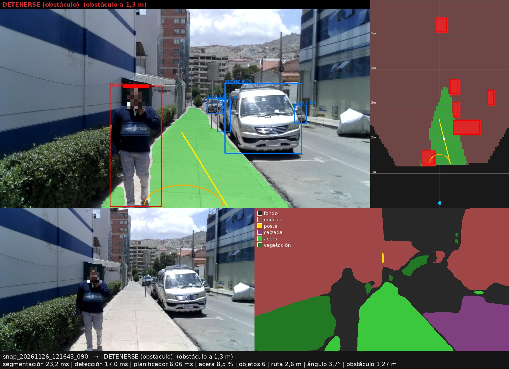
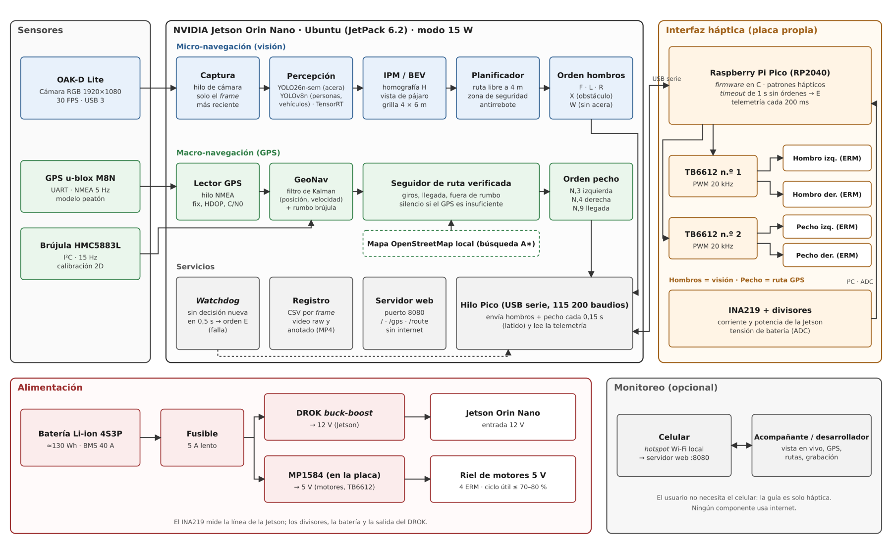
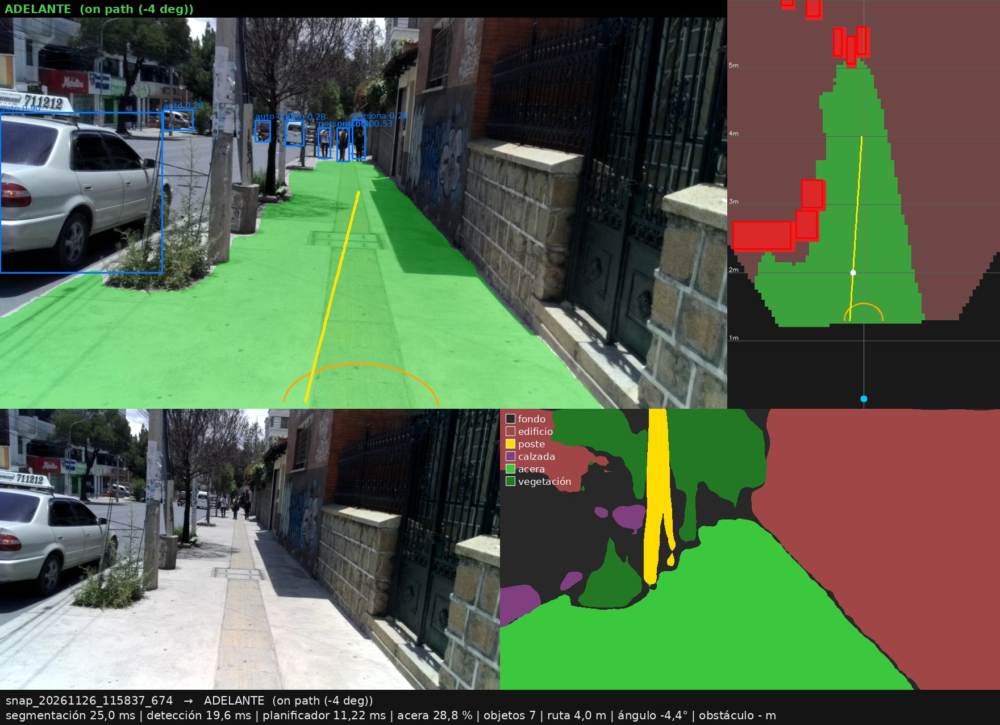
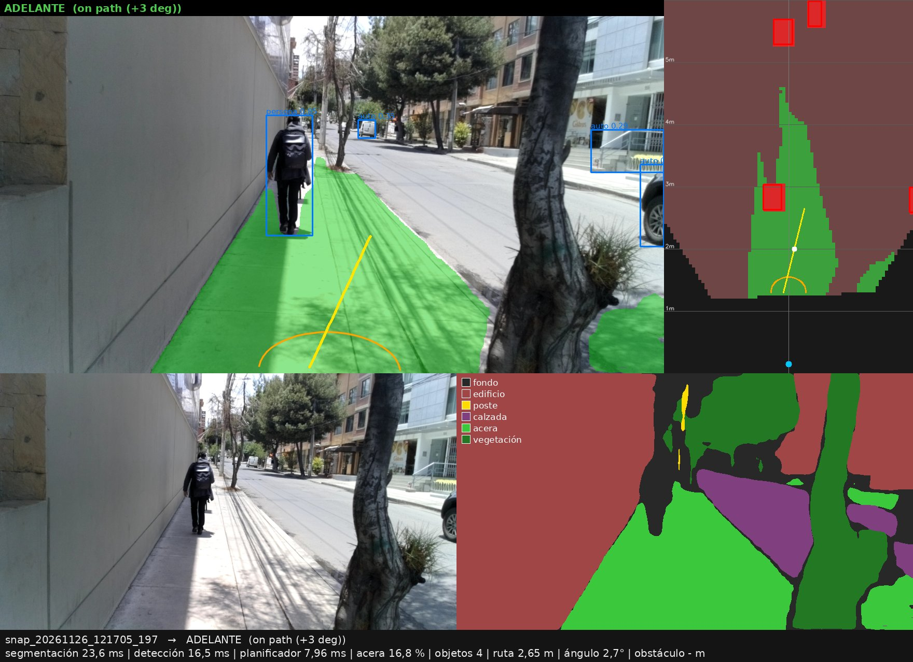
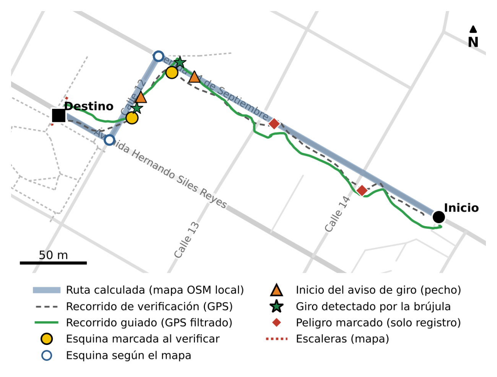
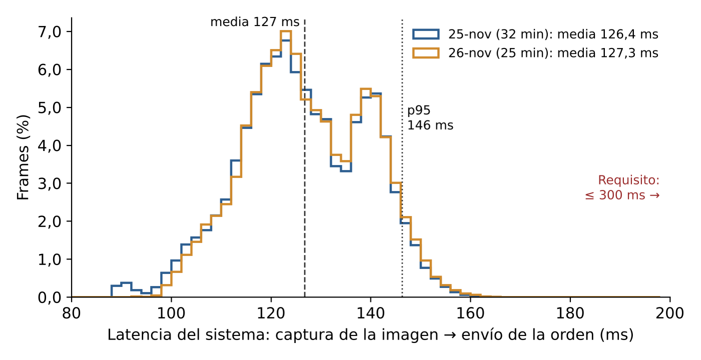

<div align="center">

# Assistive Navigation

### Arnés de navegación asistida para personas con discapacidad visual

Visión artificial y GPS procesados **en el propio dispositivo**, sin internet,<br>
con guía **háptica** (vibración) en lugar de audio.


-A22846?logo=raspberrypi&logoColor=white)




<sub>Salida real del sistema en una acera de La Paz: acera segmentada (verde), detecciones, ruta calculada (amarillo), zona de seguridad (naranja) y vista de pájaro con la huella de cada obstáculo. El peatón entra en la zona y el arnés ordena detenerse.</sub>

</div>

---

## ¿Qué es?

El bastón blanco no detecta obstáculos a la altura del torso ni ayuda a llegar a un destino, y las alternativas tecnológicas suelen ser caras o depender de una conexión a internet. **Assistive Navigation** es un prototipo de arnés que se lleva puesto y guía a la persona por la acera **mediante vibraciones**, dejando el oído libre para escuchar el entorno.

Todo el procesamiento ocurre en una **NVIDIA Jetson Orin Nano** que va en la mochila: no hay servidores, ni nube, ni datos móviles.

| | |
|---|---|
| 🦯 **Micro-navegación (visión)** | Encuentra la acera, calcula una ruta libre y avisa de obstáculos cercanos |
| 🗺️ **Macro-navegación (GPS)** | Sigue rutas sobre un mapa offline de la ciudad y avisa en cada esquina |
| 📳 **Interfaz háptica** | 4 motores: los **hombros** hablan de la acera; el **pecho**, de la ruta |
| ⚡ **Tiempo real** | ≈127 ms desde la captura hasta la orden, ≈22 FPS, ≈15 W |

---

## Cómo funciona

<div align="center">

</div>

**Cadena de visión.** La cámara OAK-D Lite entrega imágenes 1080p. Cada imagen pasa por dos redes neuronales optimizadas con TensorRT FP16:
- **YOLO26n-sem**, ajustado con un dataset propio de aceras de La Paz, segmenta acera, calzada, edificios, postes y vegetación.
- **YOLOv8n** detecta personas y vehículos.

Con un **mapeo inverso de perspectiva (IPM)** la acera se proyecta a una vista de pájaro en metros. Sobre ella, un planificador traza la franja libre y comprueba si algún obstáculo invade una **zona de seguridad** frente al cuerpo.

**Cadena de ruta.** Un GPS u-blox M8N y una brújula HMC5883L alimentan un **filtro de Kalman**. El sistema calcula rutas peatonales con **A\*** sobre un mapa de **OpenStreetMap descargado una sola vez**. Las rutas se **verifican caminando** con un acompañante, que marca cada esquina. Al guiar, la **brújula** detecta cuándo el usuario ya giró y apaga el aviso.

**Salida háptica.** Las órdenes viajan por USB serie a una **Raspberry Pi Pico** con firmware propio en C, que maneja 4 motores ERM a través de controladores TB6612FNG.

---

## Lo que ve el sistema

<table>
<tr>
<td width="50%"></td>
<td width="50%"></td>
</tr>
<tr>
<td><sub><b>Acera recta:</b> ruta libre hasta 4 m, postes y vegetación separados de la acera → <b>ADELANTE</b>.</sub></td>
<td><sub><b>Peatón a ≈2,9 m:</b> está fuera de la zona de seguridad, así que la ruta se mantiene → <b>ADELANTE</b>.</sub></td>
</tr>
</table>

### El ajuste fino importa

Los modelos entrenados en ciudades europeas (Cityscapes) no reconocen bien las aceras de La Paz. Con un dataset propio de **369 imágenes** etiquetadas a mano, publicado en [Roboflow Universe](https://universe.roboflow.com/j1nzo1/la-paz-sidewalk-segmentation):

| Modelo | IoU de acera sin ajuste | IoU de acera con ajuste |
|---|:---:|:---:|
| SegFormer-B0 | 0,27 | **0,91** |
| YOLO26n-sem (desplegado) | 0,19 | **0,92** |

---

## Navegación por rutas sin internet

<div align="center">

</div>

<sub>Ruta real de 396 m dibujada sobre el mapa que guarda el propio dispositivo: ruta calculada (azul), recorrido de verificación con esquinas marcadas (amarillo) y recorrido guiado (verde). En cada esquina, ▲ marca dónde empieza a vibrar el pecho y ★ el momento en que la brújula detecta el giro y apaga el aviso.</sub>

- **Mapa offline:** La Paz urbana, con 74 000 nodos y 2 176 km de vías caminables, incluidas las escaleras.
- **Rutas con menos giros:** cada cambio de calle se penaliza, porque cada giro es una decisión para el usuario.
- **Esquinas reales:** como el GPS civil tiene varios metros de error, las rutas se recorren antes con un acompañante, que marca cada esquina tal como la registra el GPS.
- **Fin del aviso por brújula:** el aviso de giro termina **1,6–1,9 s después de girar**. Midiendo solo la distancia del GPS, seguía vibrando hasta 45 s.

---

## Interfaz háptica

Los mensajes se distinguen por **dónde** se sienten, no por ritmos que haya que memorizar.

| Dónde | Patrón | Significado |
|---|---|---|
| — | Silencio | Seguir adelante |
| Hombro izquierdo / derecho | Pulso suave | Corregir hacia ese lado |
| Ambos hombros | Pulsos rápidos | Detenerse (obstáculo o fin de la acera) |
| Pecho izquierdo / derecho | Pulso suave | Girar hacia ese lado en la próxima esquina |
| Ambos lados del pecho | Vibración larga, una vez | Llegaste |
| Los 4 motores | 1 s continuo | Falla del sistema |

**Seguridad en capas:**
- *watchdog* en la Jetson (0,5 s) y *timeout* en la Pico (1 s);
- motores apagados por hardware si la Pico se reinicia;
- fusible y BMS en la batería.

---

## Rendimiento medido en la calle

<div align="center">

</div>

Dos recorridos reales, con 57 minutos y 76 000 frames con la guía activa:

| Métrica | Resultado |
|---|---|
| Latencia del sistema (captura → orden) | **127 ms** de media · p95 146 ms · requisito ≤ 300 ms |
| Estabilidad de la latencia | σ ≈ 10 % de la media |
| Cuadros por segundo | **22,4 FPS** (mínimo 16,9) |
| Consumo | **≈15 W** → autonomía estimada ≈7 h con la batería de 130 Wh |
| Temperatura máxima | 69 °C (lejos del límite de 99 °C) |

---

## Hardware

| Componente | Modelo |
|---|---|
| Cómputo | NVIDIA Jetson Orin Nano 8 GB (JetPack 6.2), modo 15 W |
| Cámara | Luxonis OAK-D Lite (RGB 1080p, USB 3) |
| GPS y brújula | u-blox NEO-M8N + HMC5883L |
| Control háptico | Raspberry Pi Pico (RP2040) + 3 × TB6612FNG + 4 motores ERM de 8 mm |
| Energía | Batería Li-ion 4S3P (≈130 Wh) con BMS, DROK 12 V, MP1584 5 V, INA219 |
| Placa | PCB de interconexión propia, diseñada en KiCad |

<!-- Foto del arnés: agrega docs/img/arnes.jpg y descomenta la línea siguiente
<div align="center"></div>
-->

---

## Estructura del repositorio

```
harness_app/        App principal (Python): percepción, IPM, planificador, GPS, rutas, web
  main.py           Bucle principal y registro
  perception.py     Segmentación + detección con TensorRT
  bev.py, planner.py  Vista de pájaro y planificador con zona de seguridad
  geonav.py, kalman.py  GPS + brújula + filtro de Kalman
  route.py, navroute.py Rutas A* sobre OSM, verificación y seguimiento
  web.py, route_web.py  Interfaz web de monitoreo (sin internet)
  evidence.py       Figuras de evidencia a partir de fotos o video
harness_pico/       Firmware de la Raspberry Pi Pico (C, Pico SDK)
maps/               Grafo peatonal de La Paz y rutas verificadas
modelos/            Modelos ONNX / TensorRT
scripts/, tools/    Calibración, pruebas y arranque
```

## Puesta en marcha (resumen)

```bash
# En la Jetson, con el entorno virtual activo
cd harness_app
python main.py            # abre la web de monitoreo en http://<ip-jetson>:8080
```

Desde el celular, conectado a la misma red local, se enciende la guía, se graba y se planifican y verifican rutas. Para operar no hace falta internet.

---

## Limitaciones conocidas

Es un **prototipo de investigación**, no un producto terminado.
- **Funciona solo de día:** la cámara no tiene visión nocturna.
- **No asiste el cruce de calles:** avisa el fin de la acera, pero cruzar sigue dependiendo del usuario.
- **Zona ciega de 1,3 m:** la cámara no ve el suelo inmediato. Ese tramo lo cubre el bastón; el sistema lo complementa, no lo reemplaza.
- **Suelo plano:** el IPM supone suelo plano. No detecta escaleras ni desniveles; por eso las rutas se verifican antes.
- **Error del GPS civil:** es de 3 a 12 m según el entorno.
- **Sin pruebas formales con usuarios:** la interfaz háptica no se evaluó con personas con discapacidad visual.

## Próximos pasos

- Evaluar la interfaz con usuarios reales.
- Detectar obstáculos aéreos con la cámara estéreo.
- Agregar un modo de cruce de calles que use las intersecciones del mapa.
- Distinguir obstáculos que se acercan de los que se alejan.

---

<div align="center">

**Jhoel Marín** · Ingeniería Mecatrónica · Universidad Católica Boliviana «San Pablo», La Paz

<sub>Datos del mapa © colaboradores de OpenStreetMap (ODbL)</sub>

</div>
